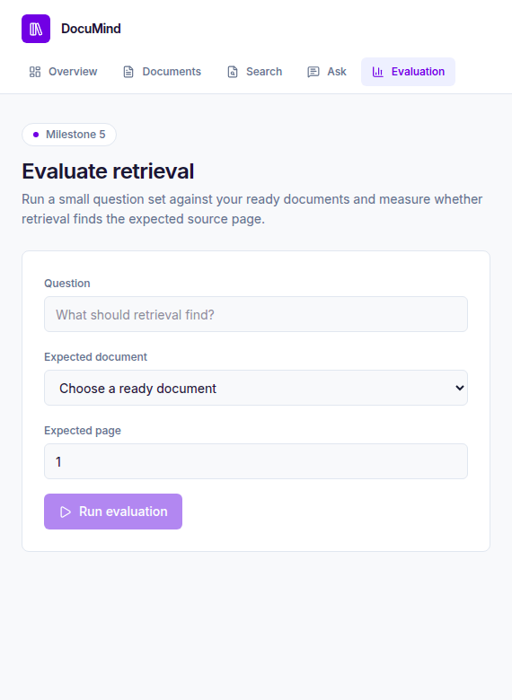

# DocuMind

DocuMind is an AI-powered document research assistant. This repository is being built incrementally as a learning project covering FastAPI, PostgreSQL, pgvector, RAG, Docker, and production-quality frontend engineering.

**Current status:** Milestone 5 complete — retrieval evaluation.



## What works today

- React + TypeScript frontend built with **Rsbuild/Rspack**
- Tailwind CSS v4 design tokens
- TanStack Query reads live API and database state
- FastAPI application with liveness and readiness endpoints
- SQLAlchemy 2 models, synchronous sessions, and Psycopg 3
- **Alembic** migrations, applied automatically when the API container starts
- PostgreSQL 16 with the **pgvector 0.8.3** extension enabled
- A single seeded development owner, read through `GET /api/v1/me`
- One consistent error envelope for every API failure
- PDF upload with streaming size limits, signature checks, and safe filenames
- A **PostgreSQL-backed ingestion worker** using `FOR UPDATE SKIP LOCKED`
- Page-aware text extraction with PyMuPDF and token chunking with `tiktoken`
- Document status UI with automatic polling while ingestion is running
- OpenAI embeddings generated during ingestion and stored in pgvector
- Semantic search API and UI with owner, readiness, document, and similarity filters
- Reprocess endpoint for failed documents and existing documents after embedding changes
- Grounded chat answers with persisted conversations, source previews, and validated citations
- Stateless retrieval evaluation with Recall@k, MRR, and page-match metrics
- Docker Compose for the web app, API, worker, and database, with health checks
- **Rstest** + React Testing Library component tests
- Pytest integration tests against a real PostgreSQL database
- Ruff and TypeScript checks
- Milestone learning log and consolidated interview guide

Grounded answer generation is intentionally not implemented yet.

## Architecture

```text
Browser
  |
  | HTTP
  v
React + Rsbuild + Tailwind
  |
  | /api/v1 (proxied by the Rsbuild dev server)
  v
FastAPI
  |
  +-- /api/v1/health        readiness, checks PostgreSQL
  +-- /api/v1/health/live   liveness, checks nothing
  +-- /api/v1/me            seeded development owner
  +-- /api/v1/documents     upload, list, get, delete
  +-- /api/v1/search        semantic search over ready chunks
  +-- /api/v1/chat          grounded answers with validated citations
  +-- /api/v1/conversations conversation history and source citations
  +-- /api/v1/evaluation/run retrieval evaluation metrics
  |
  +-----------------------------+
  v                             v
SQLAlchemy 2 + Psycopg 3     Ingestion worker
  |                             |  claims pending documents
  v                             |  extracts and chunks PDFs
PostgreSQL 16 + pgvector        |
  +-- users                     |
  +-- documents  <--------------+
  +-- document_chunks
  +-- alembic_version

Uploaded files -> shared uploads volume (read by the API and worker)
```

The browser calls relative `/api/v1/*` URLs. In development, Rsbuild proxies those requests to the API container. This avoids exposing API keys to the frontend and keeps the browser origin consistent.

The documents table is the ingestion queue. A worker claims one row at a time, changes its status to `processing`, extracts text, stores chunks, and marks it `ready` or `failed`. Status transitions are the protocol, so no Redis or Celery is required.

## Quick start

Requirements:

- Docker with Compose
- An OpenAI API key is only needed from Milestone 3 onward

```bash
cd /home/tracxn-lp-784/Desktop/documind
cp .env.example .env
docker compose up --build -d
docker compose ps
```

Open:

- Web application: <http://localhost:5173>
- API readiness: <http://localhost:8000/api/v1/health>
- API docs: <http://localhost:8000/api/docs>

Expected readiness response:

```json
{
  "status": "ok",
  "service": "DocuMind API",
  "version": "0.1.0",
  "environment": "development",
  "dependencies": {
    "database": { "status": "up", "latency_ms": 1.8, "error": null }
  }
}
```

Migrations run before Uvicorn starts, so a fresh volume is provisioned automatically. When PostgreSQL is unreachable the readiness endpoint returns `503` with `"status": "degraded"`, while the liveness endpoint keeps returning `200`.

## Local development without Docker

### API

```bash
cd services/api
python3 -m venv .venv
.venv/bin/pip install -e '.[dev]'
.venv/bin/alembic upgrade head
.venv/bin/uvicorn app.main:app --reload --port 8000
```

`alembic upgrade head` needs a reachable PostgreSQL. The default URL targets `localhost:5432/documind`; override it with `DATABASE_URL`.

### Web

```bash
cd apps/web
pnpm install
pnpm dev
```

The Rsbuild proxy targets `http://localhost:8000` unless `API_PROXY_TARGET` is set.

## Tests and checks

### Backend

```bash
cd services/api
.venv/bin/ruff check .
.venv/bin/ruff format --check .
.venv/bin/pytest -q
```

Integration tests create and migrate a separate `documind_test` database, then wrap each test in a transaction that is rolled back. PostgreSQL must be reachable; set `DOCUMIND_TEST_DATABASE_URL` to point somewhere else.

### Frontend

```bash
cd apps/web
pnpm typecheck
pnpm test
pnpm build
```

## Repository layout

```text
documind/
  apps/web/                React application
    src/app/               Router, providers, system status and documents pages
    src/components/        Shared UI components
    src/lib/               API client and utilities
    src/styles/            Tailwind entry point and design tokens
    tests/                 Rstest setup, component and client tests
  services/api/            FastAPI application
    app/api/v1/            Versioned routes and shared dependencies
    app/core/              Settings, database engine, error handling
    app/models/            SQLAlchemy models
    app/repositories/      Focused query functions and the worker claim
    app/schemas/           Pydantic request and response models
    app/services/          Storage, extraction, chunking, ingestion
    app/workers/           PostgreSQL-backed ingestion worker
    migrations/            Alembic environment and versions
    tests/                 API, service, worker, and migration tests
  infra/postgres/          PostgreSQL initialization
  docs/                    Architecture, API, RAG, learning log, and interview guide
  docker-compose.yml       Local development services
```

## Current boundaries

- Single local user; authentication is not implemented.
- One document owner, seeded by migration `0002`.
- Text-based PDFs only; scanned PDFs fail with an explicit message because OCR is not included.
- Chunking uses `cl100k_base`, 350 tokens with 50 tokens of overlap, never crossing page boundaries.
- Evaluation runs are stateless; persistent dataset management is not implemented yet.
- No secrets are present in the frontend. The OpenAI key belongs in the backend `.env` only.

## Next milestone

Milestone 6 will add persistent evaluation datasets and broader quality reporting.
