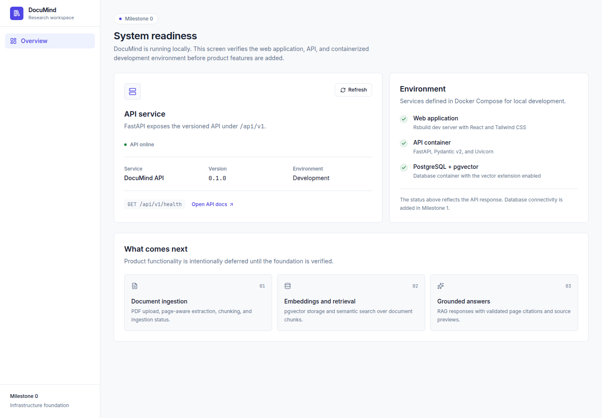

# DocuMind

DocuMind is an AI-powered document research assistant. This repository is being built incrementally as a learning project covering FastAPI, PostgreSQL, pgvector, RAG, Docker, and production-quality frontend engineering.

**Current status:** Milestone 0 complete — infrastructure foundation only.



## What works today

- React + TypeScript frontend built with **Rsbuild/Rspack**
- Tailwind CSS v4 design tokens
- TanStack Query health check against the API
- FastAPI application with `GET /api/v1/health`
- Pydantic-powered OpenAPI documentation
- PostgreSQL 16 with the **pgvector 0.8.3** extension enabled
- Docker Compose for the web app, API, and database
- Compose health checks for all three services
- **Rstest** + React Testing Library component tests
- Pytest API tests and Ruff linting

Document upload, retrieval, and RAG are intentionally not implemented yet.

## Architecture

```text
Browser
  |
  | HTTP
  v
React + Rsbuild + Tailwind
  |
  | /api/v1 (proxied by the Rsbuild dev server)
  v
FastAPI
  |
  +-- current: GET /api/v1/health
  +-- next: document, retrieval, and answer services
  |
  v
PostgreSQL + pgvector
```

The browser calls relative `/api/v1/*` URLs. In development, Rsbuild proxies those requests to the API container. This avoids exposing API keys to the frontend and keeps the browser origin consistent.

## Quick start

Requirements:

- Docker with Compose
- An OpenAI API key is only needed from Milestone 3 onward

```bash
cd /home/tracxn-lp-784/Desktop/documind
cp .env.example .env
docker compose up --build -d
docker compose ps
```

Open:

- Web application: <http://localhost:5173>
- API health: <http://localhost:8000/api/v1/health>
- API docs: <http://localhost:8000/api/docs>

Expected health response:

```json
{
  "status": "ok",
  "service": "DocuMind API",
  "version": "0.1.0",
  "environment": "development"
}
```

The `api` health check is a liveness check. PostgreSQL connectivity from the API is added in Milestone 1; the database itself is health-checked by Compose and the vector extension is verified during setup.

## Local development without Docker

### API

```bash
cd services/api
python3 -m venv .venv
.venv/bin/pip install -e '.[dev]'
.venv/bin/uvicorn app.main:app --reload --port 8000
```

### Web

```bash
cd apps/web
pnpm install
pnpm dev
```

The Rsbuild proxy targets `http://localhost:8000` unless `API_PROXY_TARGET` is set.

## Tests and checks

### Backend

```bash
cd services/api
.venv/bin/ruff check .
.venv/bin/ruff format --check .
.venv/bin/pytest -q
```

### Frontend

```bash
cd apps/web
pnpm typecheck
pnpm test
pnpm build
```

## Repository layout

```text
documind/
  apps/web/                React application
    src/app/               Router, providers, system status page
    src/components/        Shared UI components
    src/lib/               API client and utilities
    src/styles/            Tailwind entry point and design tokens
    tests/                 Rstest setup and component tests
    rsbuild.config.ts      Rsbuild configuration
    rstest.config.ts       Rstest configuration
  services/api/            FastAPI application
    app/api/v1/            Versioned routes
    app/core/              Settings and future infrastructure concerns
    app/schemas/           Pydantic response models
    tests/                 API tests
    pyproject.toml         Python dependencies and tool configuration
  infra/postgres/          PostgreSQL initialization
  docs/                    Architecture, API, RAG, and learning notes
  docker-compose.yml       Local development services
  .env.example             Environment template
```

## Current boundaries

- Single local user; authentication is not implemented.
- Health checks do not yet include database connectivity.
- No PDF upload, chunking, embedding, retrieval, or chat.
- No secrets are present in the frontend. The OpenAI key belongs in the backend `.env` only.
- Scanned PDFs will not be supported in the MVP unless OCR is explicitly added later.

## Next milestone

Milestone 1 will add SQLAlchemy, Alembic, PostgreSQL connectivity, the development owner, consistent API errors, and API integration tests.
